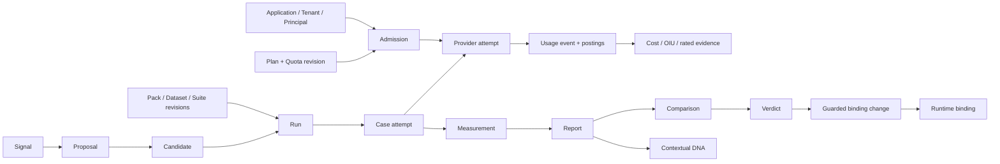

# Entity, command, query and job contracts

These are design blueprints, **not migrations or implemented endpoints**. All IDs UUID; scope column `A/T` means mandatory applicationId plus nullable tenantId with composite same-application FK; `G` means explicitly global OIC admin scope. All rows have createdAt/recordedAt and actor/producer; published revisions and observations are immutable, state rows change only through guarded transitions. Domain content lives in encrypted artifact store with digest/ACL, not generic audit JSON. Audit event links command ID and scope, while domain evidence keeps source/derivation links. Versioned DTOs must preserve unknown and evidence level.

| Entity group | Key fields, scope, mutability, relationships and constraints | Query/index and retention |
|---|---|---|
| ProviderPriceBookRevision, rate row, FxRateEvidence | UUID; G or A/T contract scope; published immutable; provider/model/dimension/unit/currency/effective interval/source; unique nonoverlap per match+precedence; FX source/time/pair | Match by provider/model/dimension/time; retain while assessments reference |
| OiuPolicyRevision, OiuAssessment | UUID; G/A/T policy scope; immutable rule digest/weights/missingness and raw-normalized inputs/output; assessment unique source+revision | By policy/source/scope/time; retain interpretation chain |
| CustomerPriceBookRevision, PlanRevision, PlanAssignment | UUID; A/T; immutable published rules; assignment effective-dated with unique active scope/priority; references entitlement/quota revisions | Current assignment by scope/time; historic by revision; no destructive referenced delete |
| Admission, Reservation/Leg, ProviderAttempt | UUID; A/T; stateful guarded; unique scope+operation+idempotency key and attempt key; pinned target/policy, fence/deadline | Active by bucket/expiry/attempt; retain for reconciliation |
| UsageEvent, UsagePosting, QuotaBalance | UUID; A/T; event/post immutable, balance projection mutable; unique physical receipt+sequence; posting group/source; bucket key scope+policy+window | Cursor by scope/time; unique source; rebuild projection; retain journal per governed policy |
| ProviderCostAssessment, InternalCostAssessment, RatedUsageEvent, ReconciliationCase | UUID; A/T; immutable assessments/adjustments, case stateful; separate journal identity; native currency/evidence/revision | Source/assessment and scope/time; no invoice claim |
| BenchmarkPack/Release, Dataset/Case/Suite/EnvironmentRevision | UUID; G or restricted A/T; published immutable manifest/digest, rights/tier/ACL; case membership unique within dataset revision | Domain/tier/status, hash and release; content retention separate |
| Campaign, Run, WorkItem, Attempt, ArtifactManifest | UUID; A/T; guarded state; logical run/case/trial unique, physical attempt unique; target fingerprint, lease fence, budget | Queue scope/status/lease, run/case, artifact digest; redact content by policy |
| Metric/JudgeRevision, Measurement, Report, Comparison, Verdict | UUID; G or A/T; published revisions/evidence immutable; exact source edges, sample/availability/interval, verdict digest/expiry | Scope/release/target, report→measurement and reverse provenance |
| DnaTraitDefinitionRevision, DnaMeasurement | UUID; G registry and A/T contextual result; immutable definition/measurement; report/trait/context required | Target+trait+release+context/time; stale computed by revision rule |
| CandidateRevision, PromotionDecision | UUID; A/T; immutable lineage/diff/verdict, decision plus state; expected binding version, prior pointer | Scope/current binding and candidate parent; retain rollback chain |
| Signal/Hypothesis/Proposal/LearningPolicyRevision | UUID; A/T; immutable published revisions, guarded proposal state; source edges, negative evidence, budget | Scope/status/source/cohort; retention per data class |
| CertificationRecord, IncidentRecord | UUID; G or A/T operational scope; immutable signed check run/incident append notes; links evidence, release and owner | Release/control/status/time; no protected content in generic record |

## Relationship graph

## Command catalog

Every command has authentication; explicit permission and A/T scope; request hash and command-specific idempotency key; expected version where stateful; DB transaction for state+audit+outbox; stable error code and committed readback. `PublishPrice/Oiu/Plan/Quota` needs policy-admin, valid nonoverlap/schema and audit; conflict returns `REVISION_CONFLICT`, readback digest. `Admit` needs runtime machine scope and current binding/policy; transaction locks all buckets and writes reserve; `EXHAUSTED|NOT_ENTITLED|BUSY` deny dispatch; readback reservation. `RecordAttempt/Receipt` needs trusted runtime producer and fence; unique source receipt; conflicting duplicate quarantined; readback attempt/posting. `Reconcile/Adjust` needs economics operator plus separate approval above threshold; append correction and projection atomically; readback journal balance. `PublishBenchmark/Metric/Judge` needs evaluator admin, rights/hash/calibration check; audit and digest. `Start/CancelRun` needs evaluation permission, published suite/target/budget and unique logical key; transaction creates work/outbox; readback run. `Score/Report` are worker-only fenced commands, reject missing artifact/revision; immutable output readback. `CreateCandidate/ApproveVerdict` needs model operator/reviewer distinct from evaluation editor; current parent and fresh comparable PASS. `Promote/Rollback` needs privileged human, verdict or emergency rollback policy, expected pointer; CAS+decision+audit; readback binding. `CreateProposal` needs learning role/allowlist, source evidence and budget; never has binding write scope. `CertifyRelease` needs operator reviewer and complete matrix; critical failure denies GO.

## Query catalog

`GetBalance/Usage/Cost/Rating` are A/T-filtered cursor pages with as-of, policy revision and evidence status; no inferred zero. `GetBenchmarkRegistry` returns metadata/rights, not sealed answers; content query needs protected role and audited purpose. `GetRun/Attempt/EvidenceGraph` returns bounded IDs/status and authorized artifact links. `CompareReports` returns comparability verdict, cohort/slice coverage, uncertainty and cost status, never an unqualified winner. `GetDNA` returns context, definition revision, source report and availability for each trait. `GetProposal/PromotionHistory` returns diff, gate, actor and prior pointer. `GetCertification` returns check artifacts/status/exception owner. Every query filters scope before aggregation and caps page size/graph depth; private content/secret fields are separate privileged paths.

## Async job catalog

`RECONCILE_ATTEMPT` retries boundedly after provider ambiguity, retains liability; `REBUILD_BALANCE` verifies posts without silent rewrite; `RUN_CASE` leases/fences and spends OIC-6 budget; `SCORE_CASE` uses pinned oracle/judge; `BUILD_REPORT` only after all planned cases terminal; `CALIBRATE_JUDGE` assesses drift; `VERIFY_PROMOTION` checks pointer and online guardrails; `CERTIFY_INTEGRITY` records discrepancies. Jobs are DB durable with unique logical key, lease generation, max attempt/deadline, cancellation and dead-letter review. Physical provider calls have separate attempt identity, and retry never presumes nonexecution. Worker crash and DB outage defer work; cache loss does not change truth. Each result belongs to domain owner and links source IDs.
