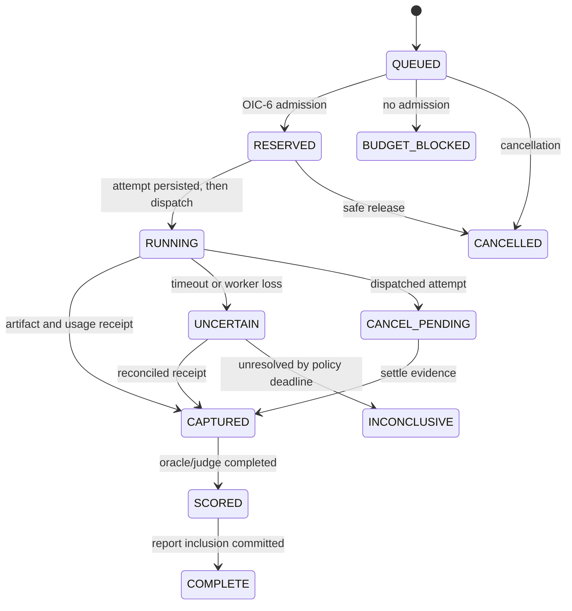

# OIC-7 v1.0 — scheduler, attempts and evidence graph

**Ownership:** Evaluation API publishes immutable registry/config; scheduler plans work; isolated runner executes; metric worker measures; report service aggregates. PostgreSQL work/outbox is authority as described in [shared operations](../../oic-6-8/cross-cutting/40_EXECUTION_SECURITY_AND_OPERATIONS.md). No claim of exactly-once provider dispatch. Every job has UUID, application/tenant scope, target/run/case revision, logical key, lease generation, deadline, max attempts, priority and OIC-6 campaign budget ID. No raw case answer in queue payload.

## Plan and state

Run request pins `BenchmarkRelease`, `SuiteRevision`, target fingerprint, case manifest, repetition seed schedule, metric/judge/aggregation revisions, compute/provider caps, rate limits, sampling design and cancellation policy. Scheduler validates rights, scope, environment compatibility and budget before creating case jobs. One logical `(runId, caseRevisionId, trialIndex)` has many physical `Attempt`s only after ambiguous failure; each attempt has unique source key and separate OIC-6 admission. Planned trial count is preregistered; operator cannot discard unlucky trials. DB queue claims use `SKIP LOCKED`, fenced lease and outbox. Work is fair across app/tenant, rate-limited per provider and bounded in-flight.

`BUDGET_BLOCKED`, `INCONCLUSIVE`, `CANCELLED`, `INVALID_ENVIRONMENT` and `FAILED` are distinct; none becomes zero quality. A worker writes attempt identity before outbound call. Crash before dispatch can release safely after fence; crash after dispatch triggers uncertain state and OIC-6 liability. Duplicate callbacks are matched by attempt ID/digest. A stale worker cannot finalize after lease transfer. Cancellation stops new jobs; dispatched attempts settle usage even if outputs are discarded. Evaluation of a case is logically idempotent by run/case/trial, while physical provider side effects may repeat and must be accounted.

## Evidence graph and reproducibility

Graph edges are typed and immutable: `Report→Measurement→(CaseRevision, Attempt, Oracle/JudgeRevision, ArtifactManifest)→(RuntimeExecution/Trace, ProviderAttempt, OIC6 Usage/Cost/OIU)`, plus `Run→Suite/Pack/Dataset/Environment/TargetFingerprint`, `Comparison→Reports`, `DnaMeasurement→Report/MetricDefinition`, `Verdict→Comparison/PolicyRevision`, `Promotion→Verdict/BindingChange`. Store edge IDs in relational rows with same-scope FKs when possible; generic EvidenceRef is an indexed cross-domain reference, not an unchecked JSON blob. Artifact manifest contains content digest, encryption class, storage locator, retention and ACL; readback verifies digest. Redacted source keeps graph node with `SOURCE_REDACTED` availability. Audit command and evidence observation remain separate.

Reproducibility level is reported per run, not promised universally. Pin adapter/container digest, provider/model identifier, versioned code, environment/corpus, parameters, seeds and exact case order. External model nondeterminism and provider updates lower level. Benchmark replay re-executes under new run ID and compares fingerprints/conditions. **Rescoring** reuses immutable captured output with new metric/judge revision and creates a new report lineage, not a rewrite; it is disallowed if artifact is redacted or metric requires live interaction. Cache reuse requires identical target, case, environment, execution policy and rights fingerprint, freshness rule and permission; no cross-tenant cache by default. Cached result is marked `REUSED` and links original paid attempt; OIC-6 cost is not fabricated on reuse.

## Economics and scheduling

Each case/adjudication/judge call obtains OIC-6 admission. Campaign budget is a hard aggregate ceiling with pessimistic reservation for remaining physical retries and judge calls. If provider cost is unknown, budget policy may use conservative upper bound; no upper bound means no dispatch. Record raw usage, provider cost evidence level, OIU and elapsed time separately. Case success denominator is predeclared; `cost per successful case` requires both measured success and valid cost coverage, and reports unknown coverage. Budget optimizer may reorder **predeclared** cases by information priority within fixed strata; it cannot silently drop hard slices. Early stopping is V1 optional and must use preregistered sequential boundaries, preserve nonexecuted count and label `EARLY_STOPPED`; no conventional fixed-sample p value after optional stopping. Adaptive sampling/IRT are future extensions behind new method revisions and calibration.

**Commands:** publish run, cancel, retry uncertain attempt after reconciliation, rescore, replay, export bounded report; each requires scope/permission, idempotency, audit and readback. **Queries:** cursor-bounded campaigns/runs/jobs/attempts, evidence graph by authorized ID, budget/coverage, report status; protected artifacts require extra role. **Indexes:** `(scope,status,priority,createdAt)`, `(leaseUntil,generation)`, unique logical work key, `(runId,caseRevisionId,trialIndex)`, attempt source key, evidence reverse references. **Alerts:** lease churn, unknown attempts, missing OIC-6 receipt, budget drift, artifact digest failure, queue age, orphan measurements. **Tests:** deterministic fixture pack, crash at each transition, duplicate callback, DB outage, cancellation, stale lease, provider timeout, budget exhaustion, scope leak, replay/rescore semantics. **Rollout:** local deterministic workers first, provider-facing workers after OIC-6 gate, advanced environments after isolation review.
